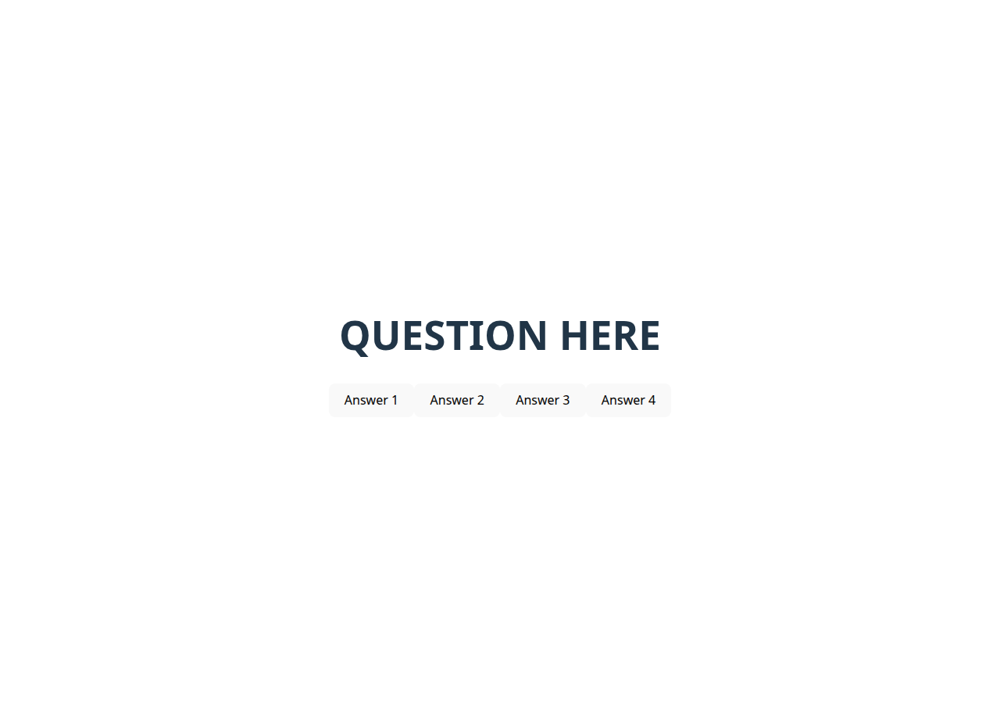

# Technical Lesson: Event Listeners

A React + Vite proof of concept for a multiple-choice quiz. Each answer button
uses an `onClick` event listener to record the user's selection, update the
component state, and display the chosen answer.



---

## Project Overview

The quiz currently contains one question with four answer buttons. Selecting an
answer:

1. Validates that the selected answer is between 1 and 4.
2. Saves the answer in the `Question` component's state.
3. Displays the selection below the buttons.
4. Logs the selection to the browser console.

---

## Component Map

```
main.jsx
└── App
    └── Question
```

- `src/main.jsx` mounts the application inside React `StrictMode`.
- `src/components/App.jsx` is the root component and renders `Question`.
- `src/components/Question.jsx` owns the answer buttons, click handler, and
  selected-answer state. It uses `src/utils/isValidAnswer.js` to reject invalid
  answer values.
- `src/components/Question.test.jsx` tests the component with Jest and React
  Testing Library.

---

## Prerequisites

- Node.js 22 or newer
- npm

---

## Run the Project

1. Install the dependencies:

   ```sh
   npm install
   ```

2. Start the Vite development server:

   ```sh
   npm run dev
   ```

3. Open the URL printed in the terminal (usually
   [http://localhost:5173](http://localhost:5173)).

Click any answer button to see the selected answer appear below the buttons and
in the browser console.

### Build for production

```sh
npm run build
npm run preview
```

---

## Available Scripts

| Command               | Description                                      |
| --------------------- | ------------------------------------------------ |
| `npm run dev`         | Start the Vite development server.               |
| `npm run build`       | Create a production build in `dist/`.            |
| `npm run preview`     | Preview the production build locally.            |
| `npm run lint`        | Run ESLint on the project.                       |
| `npm test`            | Run the Jest test suite once.                    |
| `npm run test:watch`  | Run Jest in watch mode.                          |
| `npm run test:coverage` | Run Jest and generate a coverage report.       |

---

## Testing

The project uses **Jest**, **React Testing Library**, **jest-dom**, and
**user-event** with a jsdom test environment.

Testing configuration:

- `jest.config.cjs` - Jest environment, transforms, and CSS module mocking.
- `babel.config.cjs` - Transpiles JSX and modern JavaScript for Jest.
- `setupTests.js` - Loads the `jest-dom` matchers.
- `__mocks__/styleMock.js` - Prevents CSS imports from breaking tests.

Run the tests with:

```sh
npm test
```

The test suite verifies that:

- The question and all four answer buttons render.
- Clicking an answer updates both component state and the DOM.
- Event handler output is mocked to confirm the correct answer is selected.
- Multiple rapid clicks keep the last selected answer.
- Invalid answer values are rejected by the validation helper.

---

## Screenshots


---

## In this lesson, you will be practicing how to implement event handlers within a React component.

---

## The Scenario

You are working on an online multiple-choice quiz feature for a university. They
are looking to move more of their exams online and they want a simple proof of
concept to be able to tell which answer the user selected. Your task is to
implement a new feature that can tell which button the user selected.

---

## Tasks

### Task 1: Define the Problem

- Create an event listener for users clicking on buttons.

### Task 2: Determine the Design

- **Determine Component Tree**
- **Isolate/develop design per component**

### Task 3: Develop the Code

- Add events to elements
- Create event handler function
- Call function
- Build functionality

### Task 4: Test and Refine

- Debugging and testing during coding

### Task 5: Document and Maintain

---

## Tools and Resources

- **GitHub**
- **Event Handling Documentation:** [React Events](https://react.dev/learn/responding-to-events#adding-event-handlers)

---

## Instructions

### Task 1: Define the Problem

- Create an event listener for users clicking on buttons.

### Task 2: Determine the Design

#### Component Tree

```
└── App
    └── Question
```

Currently, our tree is not too complex because we are focusing on creating
events within the `Question` component.

#### Isolate/Develop Design per Component

The design for this page is already developed! Open the page to see what it
looks like and explore the files to understand the scope of the code.

---

### Task 3: Develop the Code

#### Step 1: Setup

To get started, fork and clone the repository.

Once the code is open in VSCode, run the following commands in the terminal:

```sh
npm install
npm run dev
```

This will install all required dependencies and will open up the webpage in your
browser. Any saved changes will automatically update the page.

#### Step 2: Add Events to Elements

Modify `Question.jsx` so that it contains the following code:

```jsx
import React from "react";
function Question() {
  return (
    <>
      <h1> QUESTION HERE </h1>
      <button onClick={() => console.log("Click")}> Answer 1</button>
      <button onClick={() => console.log("Click")}> Answer 2</button>
      <button onClick={() => console.log("Click")}> Answer 3</button>
      <button onClick={() => console.log("Click")}> Answer 4</button>
    </>
  );
}
export default Question;
```

Since we need to determine which button was clicked, we use `onClick` to set up
the event listener.

#### Step 3: Create Event Handler Function and Call Function

Modify `Question.jsx` to include a handler function:

```jsx
import React from "react";
function Question() {
  function handleClick() {
    console.log("clicked");
  }
  return (
    <>
      <h1> QUESTION HERE </h1>
      <button onClick={() => handleClick()}> Answer 1</button>
      <button onClick={handleClick}> Answer 2</button>
      <button onClick={handleClick}> Answer 3</button>
      <button onClick={handleClick}> Answer 4</button>
    </>
  );
}
export default Question;
```

This approach makes the function reusable and improves readability.

#### Step 4: Build Functionality

Modify `Question.jsx` to determine which button was clicked:

```jsx
import React from "react";
function Question() {
  function handleClick(number) {
    console.log(`User selected Answer ${number}!`);
  }
  return (
    <>
      <h1> QUESTION HERE </h1>
      <button onClick={() => handleClick(1)}> Answer 1</button>
      <button onClick={() => handleClick(2)}> Answer 2</button>
      <button onClick={() => handleClick(3)}> Answer 3</button>
      <button onClick={() => handleClick(4)}> Answer 4</button>
    </>
  );
}
export default Question;
```

Now, each button click will output the selected answer in the console.

---

### Task 4: Test and Refine

- Debugging and testing during coding.
- Check the console to verify the correct button number is displayed.
- Run `npm test` to verify the component's state and DOM updates automatically.

---

### Task 5: Document and Maintain

- Add descriptions to event functions to improve code readability.
- Keep the component map and testing instructions above up to date.

---

## Considerations

### Invoking a Function

Invoking a function means calling it using parentheses `()`. In `onClick`, you
must pass a function that is **not invoked** immediately.

### Event Handling

React events are similar to standard JavaScript events. Review the documentation
to explore different event types.

Example:

```jsx
<p onClick={(e) => console.log(e)}> Clickable paragraph </p>
```

`e` (short for event) contains useful event-related information, which can be
leveraged for more complex interactions.

---

This completes the lesson on event listeners in React!
